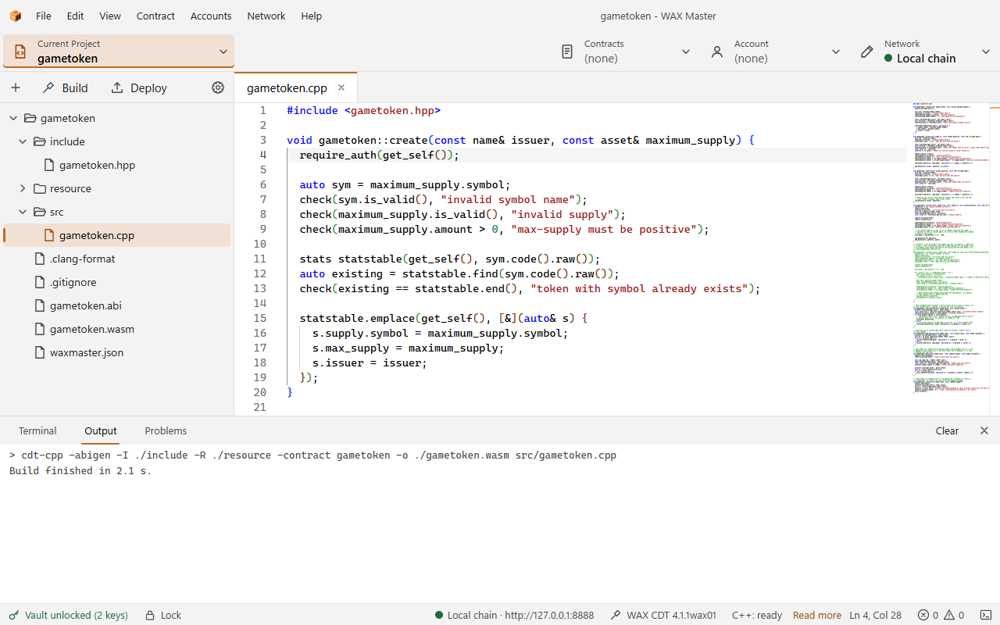
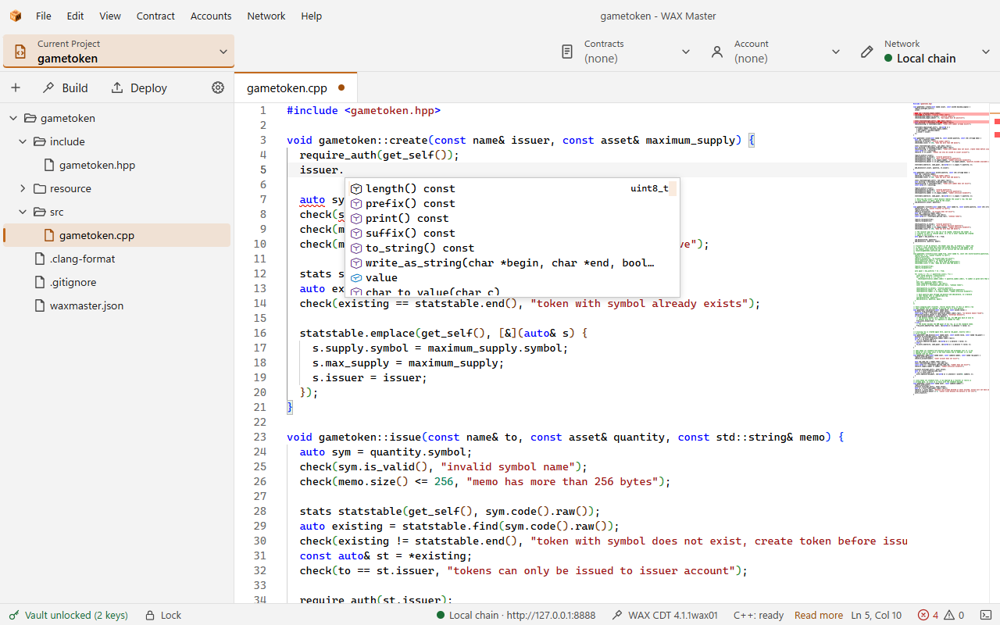
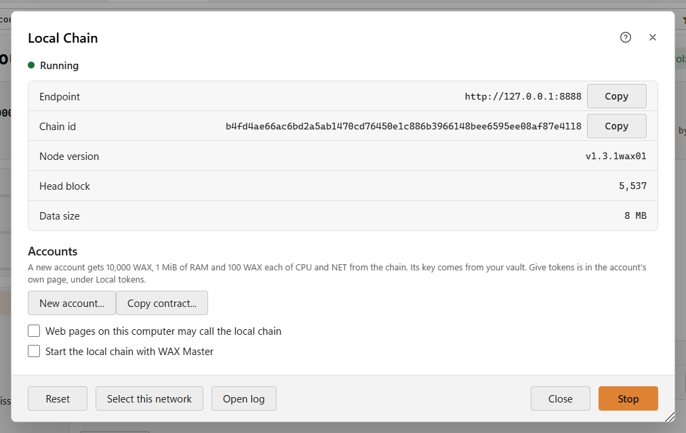
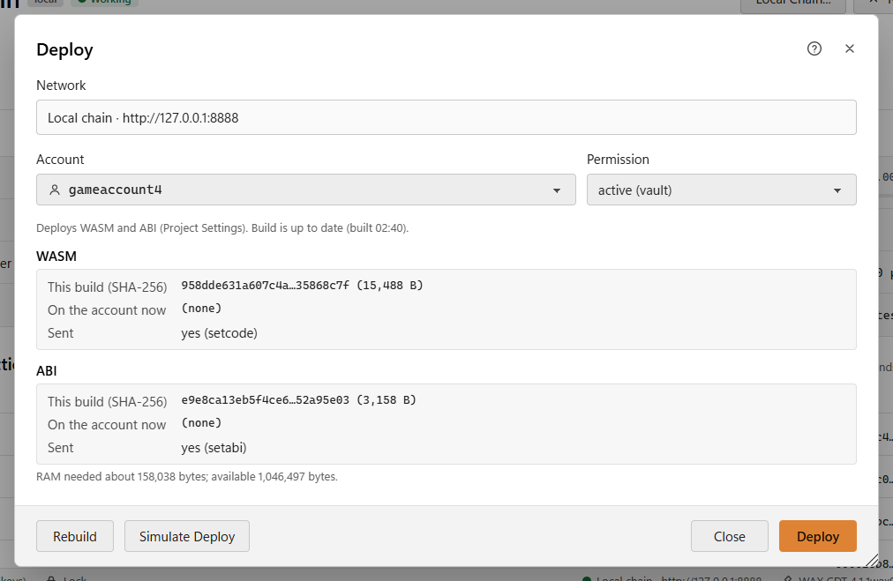
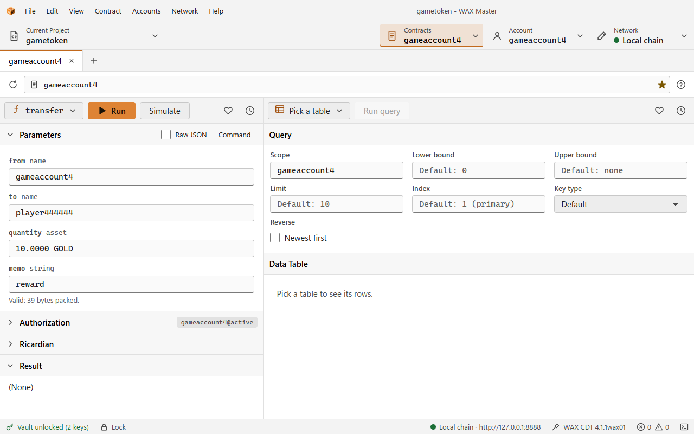
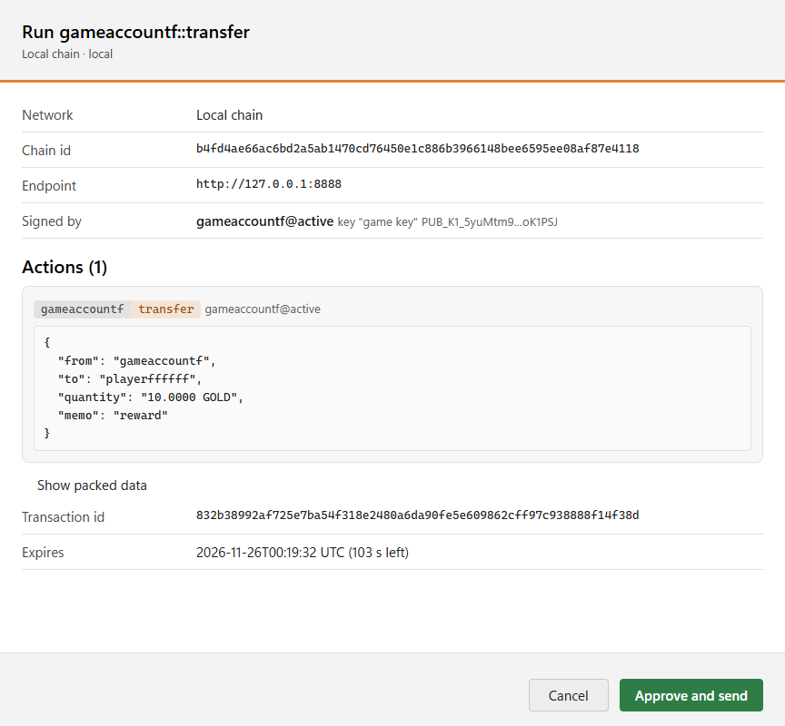
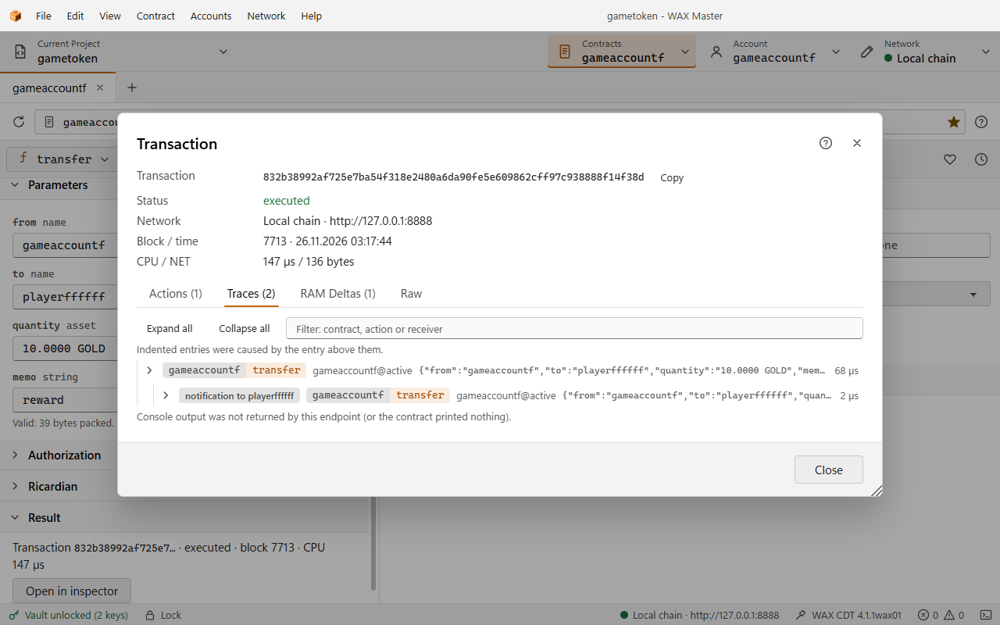
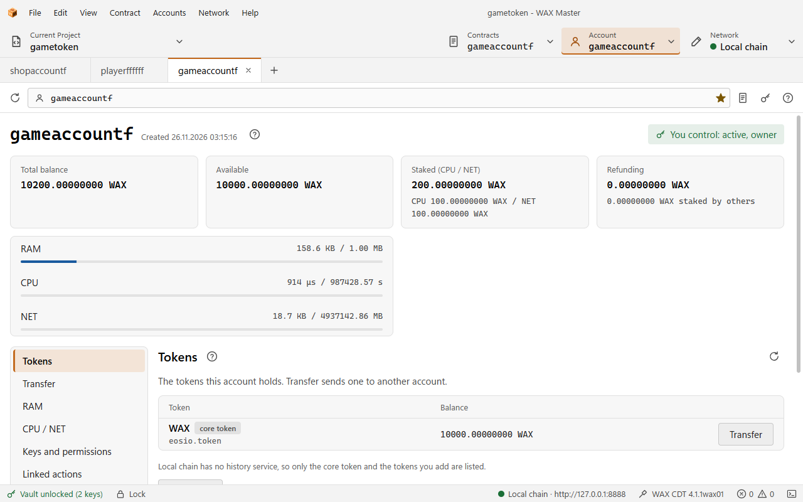
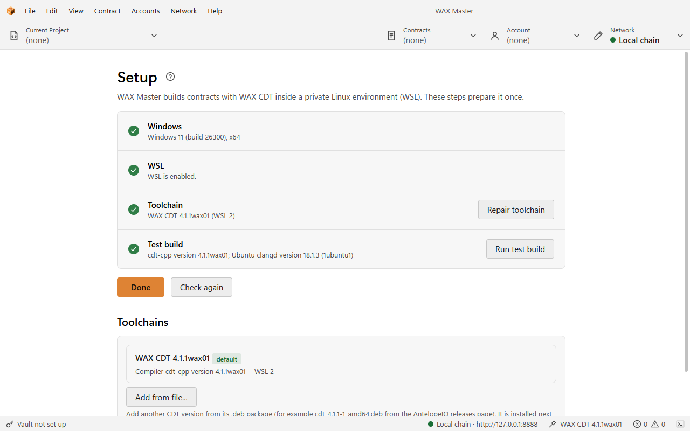

# WAX Master


A desktop studio for writing, building, deploying and using smart contracts on WAX and any other Antelope chain. Install it, open it, and build your first contract without Docker and without a terminal.

<picture>
  <source media="(prefers-color-scheme: dark)" srcset="docs/help/img/window-dark.png">
  
</picture>

The window with a project open: the menu bar and the top bar, the file tree with Build and Deploy, the editor, the bottom panel on Output after a build, and the status bar.

Windows 10 22H2 or Windows 11, x64.

## What it does

- **Projects and editor**: contract projects with a C++ editor that understands contract code (completion, live errors, go to definition into the CDT headers, find references, rename, formatting).
- **Build**: WAX CDT runs in a private Linux environment (WSL) that the app sets up by itself from files inside the installer. One button or Ctrl+B. Errors appear in the editor and in Problems.
- **Terminal**: a real integrated terminal (PowerShell, Command Prompt, and a Linux shell with the toolchain), so Git and your other tools work as usual.
- **Networks**: WAX Mainnet and WAX Testnet built in (they can be removed and restored); add any Antelope chain by its API address. A status mark shows whether the endpoint answers and keeps up with the chain; the Network page shows the chain state and the latest blocks.
- **Local chain**: Network > Local Chain sets up a private WAX chain on your own computer from files inside the installer (which is therefore about 415 MB): no Docker, no download, no faucet limit. New accounts with 10,000 WAX, the WAX system contract, reset at will. It needs WSL 2.
- **Accounts and contracts**: balances, resources, permissions and history of any account; call any action of any contract with typed forms; browse contract tables.
- **Keys**: generate or import keys into an encrypted vault (password, scrypt and AES-256-GCM). It locks when Windows sleeps or locks and after inactivity. A recovery code, shown once, sets a new password if you forget it. Keys that exist only in the vault are marked until you back them up (a backup file, an exported vault, or the key written down).
- **Themes**: follows the Windows light or dark mode, or always Dark or Light (File > Settings > Appearance).
- **Transactions you can check**: every signature is shown in a separate confirmation window that decodes the exact bytes to be signed: network, chain id, endpoint, account, permission, actions, and for a deployment the SHA-256 of the WASM and ABI. Simulate runs a transaction without sending it (unsigned) and shows the full trace in the transaction inspector.
- **Deploy**: build and deploy from a button. The deploy checks what is already on the account, skips unchanged parts, estimates RAM, and warns when the contract uses host functions the chain has not activated.
- **Wallet**: transfers, RAM, CPU and NET, PowerUp, voting and rewards, keys and permissions, linked actions, and name bids for short (premium) account names, all from the Account page.
- **Examples and documentation**: New Project offers example contracts with step-by-step READMEs, tried on WAX Testnet as far as its services answer: a transfer listener, staking, AtomicAssets minting, an Alcor swap, a random number request, NFT staking, an NFT blend and token payments that refuse look-alike tokens. Help > Documentation covers writing contracts (accepting tokens safely, checking input, changing tables, who pays for RAM and CPU, a checklist before mainnet), NFTs and game tools (AtomicAssets and its notifications, drops, packs, the services a WAX game uses), and searches by word forms, similar words and typing mistakes.

## A look at the program

<picture>
  <source media="(prefers-color-scheme: dark)" srcset="docs/help/img/editor-completion-dark.png">
  
</picture>

The editor completes contract code: after a dot the list shows what the value offers, read from the CDT headers.

<picture>
  <source media="(prefers-color-scheme: dark)" srcset="docs/help/img/local-chain-dark.png">
  
</picture>

The Local Chain dialog while the private chain runs on this computer.

<picture>
  <source media="(prefers-color-scheme: dark)" srcset="docs/help/img/deploy-dark.png">
  
</picture>

The Deploy dialog: the account, what is on it now, what will be sent and the RAM it needs.

<picture>
  <source media="(prefers-color-scheme: dark)" srcset="docs/help/img/contract-actions-dark.png">
  
</picture>

The Contract page: each action of a contract is a form with a field for every argument.

<picture>
  <source media="(prefers-color-scheme: dark)" srcset="docs/help/img/confirm-dark.png">
  
</picture>

The confirmation window for a transfer on a test network: where it goes, who signs, and every action with its data. On a mainnet the header is red.

<picture>
  <source media="(prefers-color-scheme: dark)" srcset="docs/help/img/transaction-view-dark.png">
  
</picture>

The transaction view on Traces: the action and, under it, the notifications it caused.

<picture>
  <source media="(prefers-color-scheme: dark)" srcset="docs/help/img/account-page-dark.png">
  
</picture>

The Account page: balances and resources at the top, the wallet sections below.

The same pictures are in the program under Help > Documentation, each on the page of its screen.

## Install

1. Download `WAX-Master-Setup-<version>.exe` and `SHA256SUMS.txt` from the [releases page](https://github.com/gulkonster/wax-master/releases). This is the only official download location.
2. Verify the download (next section).
3. Run the installer. It installs for your Windows user and needs no administrator rights. The installers are not code-signed yet, so Windows SmartScreen shows "Windows protected your PC": choose **More info**, then **Run anyway**.

## Verify your download

Every release installer is built by the public [release workflow](.github/workflows/release.yml) from the tagged source, and GitHub records a signed build-provenance attestation for the exact file.

1. Quick check: in PowerShell, in the folder with the download:

   ```powershell
   Get-FileHash .\WAX-Master-Setup-<version>.exe -Algorithm SHA256
   ```

   The hash must equal the line for this file in `SHA256SUMS.txt` on the release page.

2. Full check (needs the [GitHub CLI](https://cli.github.com/)):

   ```powershell
   gh attestation verify .\WAX-Master-Setup-<version>.exe -R gulkonster/wax-master
   ```

   A pass means this exact file was built by this repository's release workflow from the tagged commit. A changed byte makes it fail.

What a pass proves: where the file came from and which source it was built from. It does not prove the software has no bugs.

## First start

The Setup screen checks four things and fixes what it can:

1. **Windows**: version and x64.
2. **WSL**: if WSL is not enabled, "Enable WSL" asks for administrator permission once, Windows downloads WSL (internet needed), and a restart follows. Then open WAX Master again.
3. **Toolchain**: the app verifies the SHA-256 of every bundled part, creates a private WSL distribution and installs WAX CDT and the editor engine into it, offline, in about a minute.
4. **Test build**: builds a sample contract.

<picture>
  <source media="(prefers-color-scheme: dark)" srcset="docs/help/img/setup-dark.png">
  
</picture>

The Setup screen after all four checks have passed: Windows, WSL, the toolchain and a test build.

"Skip" keeps editing, chain work and the terminal available; building and code intelligence need the toolchain.

Then: **New > Hello World**, and **Ctrl+B**.

Existing EOS Studio projects open as they are (File > Open Project); settings are taken from `.eosproj`, except its build script.

## Security limits

- A computer that is already infected cannot be made safe by this app.
- Keep the owner keys of valuable accounts out of the app. Use dedicated permissions for deploying and daily actions.
- When the vault is created you get a recovery code, shown once: keep it away from this computer. With it, "Forgot password?" on the unlock prompt sets a new password. Without the password and the code the keys cannot be opened, so also export a backup (Manage Keypairs > Vault > Export vault; it opens with the same password or the recovery code) or back up single keys. A single-key backup file holds the private key as readable text: keep it off this computer.
- The terminal is your own shell; commands you run there act with your rights.
- A project's custom build command runs only after you approve it, and runs with your rights inside the toolchain environment.
- Simulation runs against the current chain state and skips authorization checks, so a real transaction can still fail.
- Verify installers as described above before first use.
- A copied private key stays in Windows clipboard history (Win+V) or in clipboard tools if you use them; the app clears only the normal clipboard after 30 seconds.
- Networks you add yourself count as mainnet (red confirmation, typed account names) unless they are marked as test networks; the WAX Mainnet chain id is always treated as mainnet.
- The app contacts only the endpoints and history services of the networks in your network list, the GitHub release check (can be turned off), the WAX Testnet faucet (https://faucet.waxsweden.org) when you press Create Testnet Account or a request-tokens button, and pages you open yourself. Help > Documentation > "What the app contacts" lists every case and the addresses of the built-in networks.

See [SECURITY.md](SECURITY.md) to report a vulnerability.

## Build from source

Requirements: Node.js 24, Git, Windows x64.

```powershell
npm ci
node scripts/fetch-toolchain-parts.mjs
npm run dev
```

- `npm test`: offline tests, including the release checks for transaction correctness (compared with an independent implementation and real WAX transactions) and approval integrity.
- `npm run dist`: Windows installer in `dist/`.
- `npm run check:doc-samples`: builds every C++ sample of the help pages with the installed toolchain (needs WSL and Help > Setup; not part of `npm test`).

See [CONTRIBUTING.md](CONTRIBUTING.md).

## License

MIT, see [LICENSE](LICENSE). Third-party software: [THIRD_PARTY_NOTICES.md](THIRD_PARTY_NOTICES.md).

Built with the help of AI coding tools. Design, decisions and real-device testing by gulkonster.
